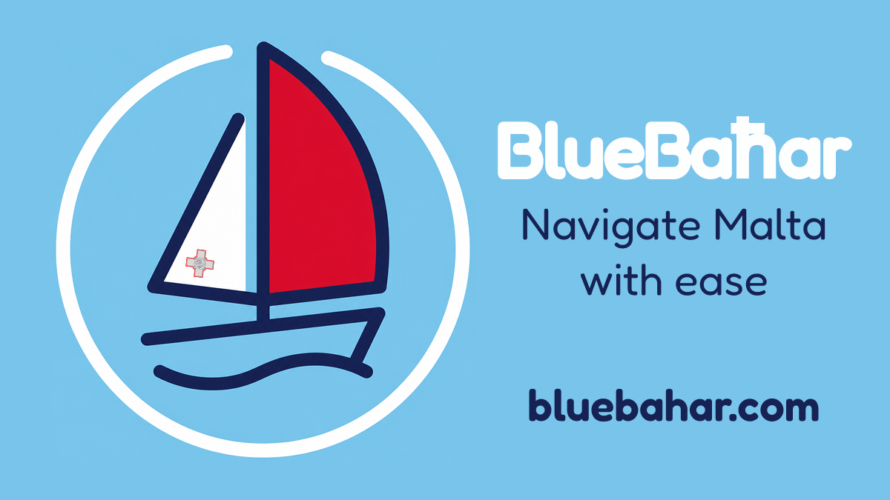

# BlueBaħar

**Know before you go out at sea.**

BlueBaħar helps you navigate Maltese waters with confidence. It puts notices to
mariners, hazards, restricted zones, protected areas and weather forecasts
around Malta on one simple map, with real-time updates when something new is
published.

## What it shows

| Layer | What you get |
|---|---|
| Notices to mariners | New notices and navigation alerts, as they come out |
| Hazards | Dangers to navigation, marked on the map |
| Restricted zones | Prohibited areas you shouldn't enter |
| Protected areas | Marine protected areas around the islands |
| Weather | Forecasts for the waters around Malta |

## Free, no strings

No account, no ads. Open the app and the map is there.

Get it on the [App Store](https://apps.apple.com/mt/app/blueba%C4%A7ar/id6766516415)
or [Google Play](https://play.google.com/store/apps/details?id=com.bluebahar.mt).
More at [bluebahar.com](https://bluebahar.com).
